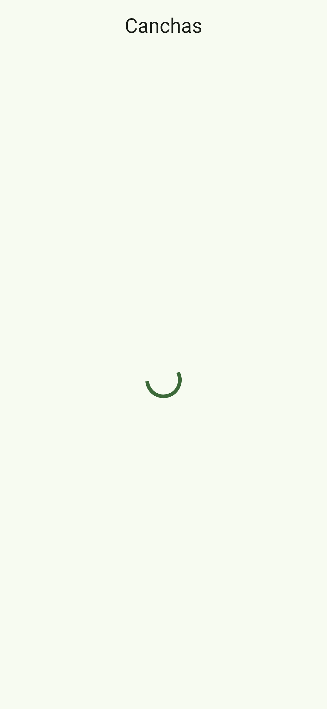
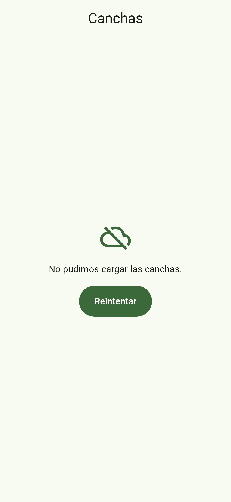
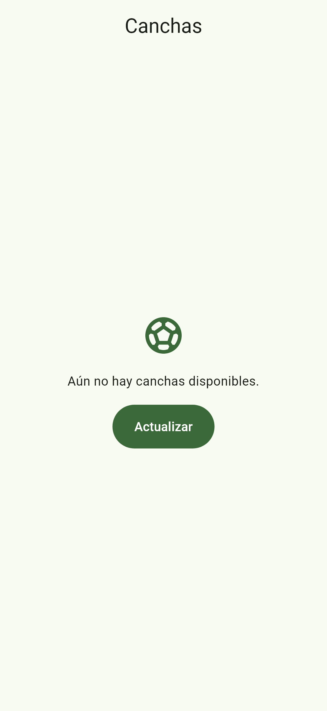
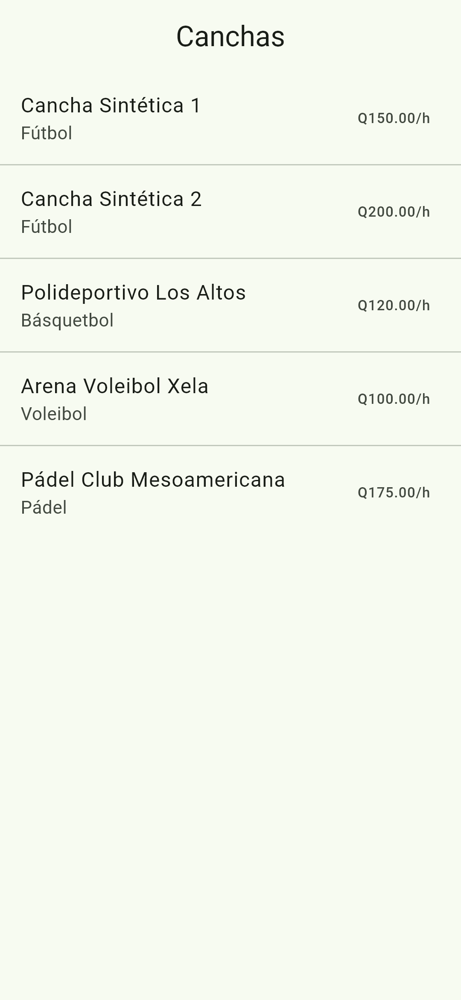

# Guía visual — ReservaCancha 2.0

Reglas visuales y de textos de la app. Reemplaza los wireframes de Figma del issue #8: describe la app **tal como está implementada**, con sus capturas reales. Si cambias una pantalla, sigue esta guía; si cambias la guía, actualiza también `lib/core/theme/app_theme.dart`.

## Principios

1. **Material 3 sin personalizaciones innecesarias.** Usamos los componentes de Flutter con el tema global; una pantalla no define colores ni tamaños de letra propios.
2. **Lo importante, abajo y a mano.** La acción principal de cada pantalla es un `FilledButton` de ancho completo al pie (Continuar, Confirmar reserva, Guardar cambios).
3. **Siempre hay algo que hacer.** Ningún estado deja al usuario sin salida: el error tiene **Reintentar**, la lista vacía tiene **Actualizar** o **Ver todas**, lo borrado tiene **Deshacer**.
4. **Mensajes humanos en español.** Nunca se muestra un error técnico de Firebase (ver [Textos](#textos)).

## Color

El esquema se genera con `ColorScheme.fromSeed` a partir de un solo color semilla, un **verde deportivo**:

```dart
// lib/core/theme/app_theme.dart
static const Color semilla = Color(0xFF2E7D32);
```

Material 3 deriva de la semilla todos los roles. Estos son los valores reales del tema claro:

| Rol | Hex | Dónde se usa |
|---|---|---|
| `primary` | `#3C6939` | Botones principales, chip seleccionado, precio por hora, ícono de los estados vacíos |
| `onPrimary` | `#FFFFFF` | Texto sobre `primary` |
| `primaryContainer` | `#BCF0B4` | Fondo de la tarjeta cuando la cancha no tiene foto |
| `onPrimaryContainer` | `#245024` | Ícono del deporte sobre `primaryContainer` |
| `secondary` | `#52634F` | Reservado; hoy no se usa directamente |
| `secondaryContainer` | `#D6E8CE` | Indicador de la pestaña activa en la barra inferior |
| `tertiary` | `#38656A` | Reservado; hoy no se usa |
| `error` | `#BA1A1A` | Fondo al deslizar para borrar, textos de validación |
| `onError` | `#FFFFFF` | Ícono de basurero sobre `error` |
| `surface` | `#F7FBF1` | Fondo de las pantallas |
| `onSurface` | `#191D17` | Texto principal |
| `onSurfaceVariant` | `#424940` | Texto secundario: deporte, ubicación, fechas |
| `outline` | `#72796F` | Bordes de campos y chips sin seleccionar |
| `surfaceContainer` | `#ECEFE6` | Fondo de la barra inferior |

**Reglas**
- En el código se usa el **rol**, nunca el hex: `Theme.of(context).colorScheme.primary`, no `Color(0xFF3C6939)`.
- El estado de una reserva se comunica con texto ("Confirmada", "Cancelada"), no solo con color.
- Para cambiar la identidad de la app basta con cambiar `semilla`: todo el esquema se recalcula.

## Tipografía

Fuente del sistema (Roboto en Android, San Francisco en iOS) con la escala de Material 3. Se usa siempre un estilo del tema (`Theme.of(context).textTheme`), nunca un `fontSize` suelto.

| Estilo | Tamaño / peso | Dónde se usa |
|---|---|---|
| `headlineSmall` | 24 / regular | Iniciales en el avatar del Perfil |
| `titleLarge` | 22 / regular | Nombre en el Perfil, total en Confirmar reserva |
| `titleMedium` | 16 / medio | Nombre de la cancha en la tarjeta, precio, día en el selector de fecha |
| `titleSmall` | 14 / medio | Encabezados de sección: "Fecha", "Hora · …", "Activas (n)", "Archivadas (n)" |
| `bodyMedium` | 14 / regular | Texto general y subtítulos de las listas |
| `bodySmall` | 12 / regular | Notas al pie (por ejemplo, "El pago se realiza en la cancha…") |
| `labelLarge` | 14 / medio | Texto de botones y chips |

El `AppBar` centra el título en todas las pantallas (`centerTitle: true`).

## Espaciado y medidas

Retícula de **4 px**; los valores que se usan son 4, 8, 12, 16 y 24.

| Medida | Uso |
|---|---|
| **16** | Margen de pantalla, relleno de tarjetas y separación entre campos de un formulario |
| **24** | Relleno de los estados vacío y error, y de las pantallas de login y registro |
| **12** | Separación entre tarjetas del listado |
| **8** | Separación entre chips y entre líneas relacionadas |
| **48** | Alto mínimo de los botones principales (`FilledButton`) y de cualquier área táctil |
| **88** | Espacio libre al final de una lista con botón flotante, para que no tape la última fila |
| **16:9** | Proporción de la foto de la cancha en la tarjeta y en el detalle |

## Íconos

Material Icons. Cada deporte tiene su ícono (`lib/features/canchas/presentation/deportes.dart`):

| Deporte | Valor en Firestore | Ícono |
|---|---|---|
| Fútbol | `futbol` | `Icons.sports_soccer` |
| Básquetbol | `basquetbol` | `Icons.sports_basketball` |
| Voleibol | `voleibol` | `Icons.sports_volleyball` |
| Pádel | `padel` | `Icons.sports_tennis` |
| Otro | — | `Icons.stadium` |

Barra inferior: versión *outlined* para la pestaña inactiva y rellena para la activa (`sports_soccer`, `event_note`, `admin_panel_settings` y `person`). Estados: `cloud_off` para error de conexión, `search_off` para algo que ya no existe, `filter_alt_off` para un filtro sin resultados y `event_busy` para una reserva imposible.

## Componentes

| Componente | Widget | Reglas |
|---|---|---|
| **Tarjeta de cancha** | `CanchaCard` | Foto 16:9 arriba; si no hay foto o no carga, el ícono del deporte sobre `primaryContainer`. Debajo, nombre (`titleMedium`), deporte (`onSurfaceVariant`) y precio por hora en `primary`. Toda la tarjeta se toca. |
| **Filtro por deporte** | `FiltroDeporteChips` | `ChoiceChip` en fila con desplazamiento horizontal; la primera opción es **Todos**. El mismo widget sirve para el cliente y para admin. |
| **Selector de fecha y hora** | `ChoiceChip` | Fechas: 7 días, el primero dice **Hoy**, sin palomita. Horas: `HH:00`; las ocupadas y las que ya pasaron se ven deshabilitadas, no se ocultan. |
| **Acción principal** | `FilledButton` | Ancho completo, al pie, dentro de `SafeArea`. Mientras se guarda, se deshabilita y muestra un `CircularProgressIndicator` de 20 px. El texto dice qué pasará: "Continuar · 18:00 – 19:00", "Confirmar reserva", "Crear", "Guardar cambios". |
| **Acción secundaria** | `OutlinedButton` | Una por pantalla, por ejemplo **Cerrar sesión**. |
| **Crear en una lista** | `FloatingActionButton.extended` | Con ícono `add` y texto (**Nueva**). |
| **Barra inferior** | `NavigationBar` | Canchas, Mis reservas, Admin (solo administradores) y Perfil. Cada pestaña conserva su scroll y sus filtros. |
| **Borrar** | `Dismissible` | Deslizar a la izquierda, fondo `error` con ícono de basurero. Primero se borra en la base; si falla, la fila vuelve. |
| **Confirmación** | `AlertDialog` | Solo para acciones que el usuario no puede deshacer solo: cancelar una reserva y cerrar sesión. Pregunta concreta y dos botones: el que cancela a la izquierda y el que confirma a la derecha. |
| **Aviso** | `SnackBar` | Resultado de una acción. Si se puede revertir, lleva **Deshacer**; si hay una alternativa, la ofrece (**Desactivar**). |
| **Activa / archivada** | `Switch` | En la fila de la cancha y en su formulario. Una cancha archivada se lista aparte ("Archivadas") y deja de verse para los clientes. |
| **Formularios** | `TextFormField` | Etiqueta arriba, validación al enviar y error bajo el campo. Los opcionales lo dicen en la etiqueta: "Descripción (opcional)". |

## Estados de una pantalla

Toda pantalla que carga datos muestra uno de estos cuatro estados con `AsyncValue.when`. Error y vacío usan `MensajeConAccion` (ícono 48 en `primary`, mensaje centrado y un botón):

| Estado | Qué se ve | Botón |
|---|---|---|
| Cargando | `CircularProgressIndicator` centrado | — |
| Error | `cloud_off` y "No pudimos cargar …" | **Reintentar** |
| Vacío | Ícono del tema y qué hacer, por ejemplo "Aún no hay canchas disponibles." | **Actualizar**, **Ver todas** o **Ver canchas** |
| Datos | La lista o el contenido | — |

| Cargando | Error | Vacío | Datos |
|---|---|---|---|
|  |  |  |  |

## Textos

- **Español y de tú:** "Elige una hora", "Intenta de nuevo".
- **El error dice qué pasó y qué hacer**, en primera persona del plural: "No pudimos guardar la cancha. Intenta de nuevo." Nunca se muestra el código de Firebase (`permission-denied`, `invalid-credential`…).
- **Los errores de reglas de negocio explican la salida:** "Tiene 3 reservas. Desactívala para dejar de mostrarla." y "Ya existe una cancha con ese nombre."
- **Los nombres de cancha van entre comillas latinas:** «Cancha Sintética 1» eliminada.
- **Formatos:** precio `Q150.00/h` (`formatearMoneda`), hora `18:00` y bloque `18:00 – 19:00` (`formatearHora`, `formatearBloque`), fecha larga "lunes 26 de octubre" (`formatearFechaLarga`). En Firestore la fecha se guarda como `yyyy-MM-dd`.
- **Los botones son verbos** que dicen el resultado: Crear, Guardar cambios, Confirmar reserva, Reintentar, Deshacer.

Pendiente de unificar: algunos mensajes de reservas y de Perfil todavía dicen "No se pudo …"; la forma de la guía es "No pudimos …".

## Accesibilidad

- Áreas táctiles de al menos 48 × 48.
- La foto de la cancha tiene `semanticLabel` con el nombre, y el ícono que la reemplaza, el nombre del deporte.
- El estado y la disponibilidad se dicen con texto o con el componente deshabilitado, no solo con color.
- Los colores salen del esquema de Material 3, que cumple el contraste mínimo entre cada rol y su `on…`.

## Pantallas

| Pantalla | Capturas |
|---|---|
| Inicio de sesión y registro | [login](capturas/17-pantallas-auth/1-login.png) · [registro](capturas/17-pantallas-auth/2-registro.png) |
| Redirección por rol | [error de login](capturas/7-redireccion/1-login-error.png) · [cliente](capturas/7-redireccion/2-cliente-sin-admin.png) · [admin](capturas/7-redireccion/3-admin-con-admin.png) |
| Listado de canchas y filtro | [listado](capturas/18-listado-canchas/1-listado.png) · [filtro](capturas/18-listado-canchas/2-filtro-futbol.png) · [vacío por filtro](capturas/18-listado-canchas/3-vacio-segun-filtro.png) |
| Barra de navegación | [1](capturas/30-navegacion/1-navegacion.png) · [2](capturas/30-navegacion/2-navegacion.png) · [3](capturas/30-navegacion/3-navegacion.png) · [4](capturas/30-navegacion/4-navegacion.png) |
| Mis reservas | [cargando](capturas/25-estados-mis-reservas/1-cargando.png) · [error](capturas/25-estados-mis-reservas/2-error.png) · [vacío](capturas/25-estados-mis-reservas/3-vacio.png) · [datos](capturas/25-estados-mis-reservas/4-datos.png) |
| Perfil | [datos](capturas/44-perfil/1-perfil.png) · [confirmar cierre](capturas/44-perfil/2-confirmar-cierre.png) · [error](capturas/44-perfil/3-error.png) |
| Gestión de canchas (admin) | [crear y editar](capturas/61-crud-canchas/1-get-post-canchas.png) · [nombre repetido](capturas/61-crud-canchas/2-cancha-repetida.png) · [archivadas](capturas/61-crud-canchas/3-archivadas.png) · [sin reservas](capturas/61-crud-canchas/4-cancha-sin-utilizar.png) · [en uso](capturas/61-crud-canchas/5-borrar-cancha-con-reserva-notificacion.png) |

Faltan capturas del detalle de cancha y de Confirmar reserva; se agregan en el siguiente PR que toque esas pantallas.
